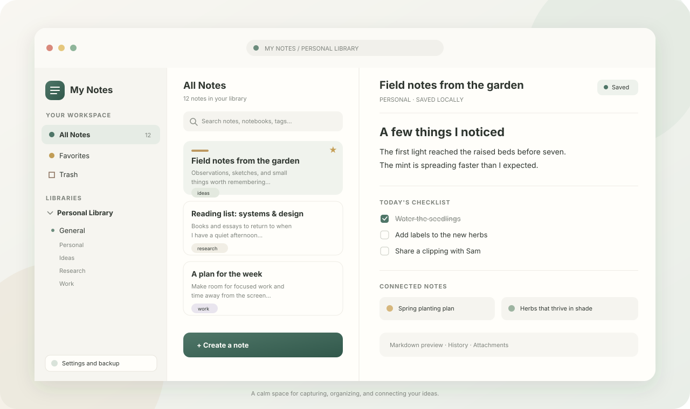

# My Notes

**A private, offline-first home for notes and personal knowledge.**

My Notes is an installable web app for capturing ideas, organizing them into a
personal library, and connecting related notes. It runs in the browser and
stores your content on your device. There is no account, cloud sync, or
AI-powered processing.



*Illustrative view of the workspace and its main areas.*

## What you can do

- **Write comfortably:** Markdown with live preview, checklists, tables, maths,
  diagrams, code highlighting, slash commands, templates, daily notes, quick
  notes (Alt+N), and a command palette (Ctrl+K). Notes save as you type, with
  restorable history.
- **Keep things organized:** libraries, shelves, notebooks, tags, favorites, and
  pins.
- **Find and connect ideas:** `[[wikilinks]]` with section links and embedded
  notes, backlinks, search with filters (`tag:`, `has:task`, `after:7d`, and
  more) and saved searches, and a graph of the whole library.
- **Keep useful context nearby:** attach files, preview images, and record
  audio.
- **Never lose a note:** Trash, automatic backups to a folder (proven by
  restoring each one) or backup reminders, a repair check at start-up, and
  upgrades tested against every past version.
- **Move your notes freely:** export as Markdown files, and import from
  Obsidian, Notion, Evernote, Google Keep, Apple Notes, and Markdown folders.
- **Use it anywhere:** install it on a computer or phone; it works offline.
- **In your language:** English, Spanish, and Arabic (right to left).

## Get started

Requirements: Node.js and npm for local development; a modern browser with
IndexedDB for using the app.

```bash
npm ci
npm run dev
```

Open the local URL printed by Vite. To create and serve a production build:

```bash
npm run build
npm run preview
```

The production build includes a web app manifest and a service worker that
precaches the app shell. Install My Notes from the browser's install control on
supported devices. Production service workers require HTTPS; localhost is
supported for development.

### Navigate the library

The workspace has a collapsible sidebar on desktop and a menu-controlled
navigation drawer on narrower screens. Open it to reach All Notes, Favorites,
Trash, Knowledge Graph, libraries, shelves, notebooks, tags, and Settings.
Use the disclosure controls to expand or collapse library and shelf contents.
The main view includes breadcrumbs when you are inside a library, shelf, or
notebook.

## Your data and privacy

Notes, relationships, attachments, settings, and history are stored in the
browser's IndexedDB database on the current device and browser profile. My Notes
has no account and sends your notes nowhere; see the [privacy policy](PRIVACY.md).
It does not synchronize between devices: use automatic backups to a folder your
cloud drive syncs, or export and import, to move notes between them.
Data is also scoped to the app's origin: changing hostname, port, or browser
profile can make a different local database appear. Clearing browser site data
can remove locally stored content. If notes appear missing, do not clear site
data; first check that you opened the same app URL and browser profile. Export
a backup from **Settings** and keep a copy somewhere separate from the browser
profile.

Backups include note content and metadata, Trash, attachments, note links,
libraries, shelves, notebooks, and history. Import validates the file and
merges it without replacing existing notes. See the [complete app guide](docs/APP_GUIDE.md)
for storage, backup, migration, and feature details.

## Project documentation

- [Complete app guide](docs/APP_GUIDE.md) — features, usage, data handling,
  architecture, and development.
- [Library catalog](docs/LIBRARY_CATALOG.md) — proposed subject libraries and
  their shelves and notebooks.
- [UI design direction](docs/UI_DESIGN.md) — library-first information
  architecture, responsive navigation, and accessibility requirements.
- [Product roadmap](docs/ROADMAP.md) — current status and future direction.
- [Code and data-safety audit](docs/AUDIT.md) — audit findings, severities,
  and recommended fix order.
- [Architecture vision](docs/ARCHITECTURE_VISION.md) — long-term technical
  direction for a world-class, AI-free platform; read before proposing
  architectural changes.
- [Performance baseline](docs/PERFORMANCE.md) — benchmark method, current
  numbers against targets, and the causes to fix first.
- [Decisions](docs/DECISIONS.md) — storage, sync, editor, business model,
  platforms, and hosting, and why.
- [Translating](docs/TRANSLATING.md) — the languages, right-to-left support,
  and how to add a language.
- [Accessibility](docs/ACCESSIBILITY.md) — the WCAG 2.2 AA target, what is
  checked automatically, and the manual checks.
- [Privacy policy](PRIVACY.md) and [security policy](SECURITY.md).

## Development

```bash
npm run lint   # ESLint (TypeScript and React rules)
npm test       # Vitest and React Testing Library
npm run test:e2e  # Playwright in Chromium, Firefox, and WebKit (production build)
npm run bench     # Performance benchmarks with generated libraries (see docs/PERFORMANCE.md)
npm run build  # TypeScript project checks and production PWA build
```

The app is built with React, TypeScript, Vite, Tailwind CSS, IndexedDB (`idb`),
and `vite-plugin-pwa`. Tests use Vitest, React Testing Library, and
`fake-indexeddb`.

## Licence

My Notes is free software under the [MIT licence](LICENSE).
